<picture>
  <source media="(prefers-color-scheme: dark)" srcset="https://raw.githubusercontent.com/Ank-co/Ank-co/main/assets/header-dark.svg?v=2">
  <source media="(prefers-color-scheme: light)" srcset="https://raw.githubusercontent.com/Ank-co/Ank-co/main/assets/header-light.svg?v=2">
  
</picture>

## Experience

**AI Engineer Intern, Thales** · April to September 2026

Designed and built an automated AI agent system that optimizes scientific Python code for the space industry.

- Multi-agent pipeline (LangGraph) in which LLMs propose code optimizations
- Deterministic validation of every candidate, numerical correctness and statistically robust performance measurement, so the LLM never validates its own work
- Retrieval-augmented generation over a curated corpus of HPC optimization patterns
- Benchmarking on an HPC cluster (SLURM)

The code is proprietary, which is why part of my 2026 activity on this profile is in a private repository.

## Projects

- **[Affection-Sycophancy](https://github.com/Ank-co/Affection-Sycophancy)**: does a user's affection make a language model adopt their false beliefs? A pre-registered study, behaviour first, then inside the network, run locally on a laptop GPU. The same loving conversations make Qwen3-8B more compliant and Qwen3.6-35B firmer (about 250,000 trials). Inside Qwen3-8B, activation patching and the logit lens show that the affection is absorbed in the middle layers and changes the answer only from layer 25, spread over many dimensions rather than carried by one steerable direction.
- **[Bulls, Bears and Gamblers](https://github.com/Ank-co/Bulls-Bears-and-Gamblers)**: language models in markets, measured on a laptop GPU. A 1.7B model fine-tuned with LoRA reads market sentiment better than a 35B model used zero-shot (macro-F1 0.884 vs 0.757), and pre-registered experiments show that removing a model's refusal behaviour makes it follow gambling clients instead of protecting them, across three model families.
<!--
- **[HandTrackingAR](https://github.com/Ank-co/HandTrackingAR)**: real-time visual effects on the hands. Python (MediaPipe, OpenCV) tracks both hands and detects gestures, then streams them to Unity, which renders a fire effect on each hand.
-->

## Education

- **MSc in Applied Economics, Data Engineering & Econometric Evaluation**, Université d'Angers (2026)
- First-year thesis: *The World Order of Corruption* (2025)

## Skills

Python · PyTorch · NumPy · LangGraph · LLM agents · LoRA fine-tuning · RAG (FAISS, embeddings) · llama.cpp · Mechanistic interpretability (activation patching, logit lens, steering) · HPC / SLURM · Econometrics · Mixed-effects models · Statistical testing · Pre-registration · Power BI · Git

## Contact

antoine.dv@icloud.com
